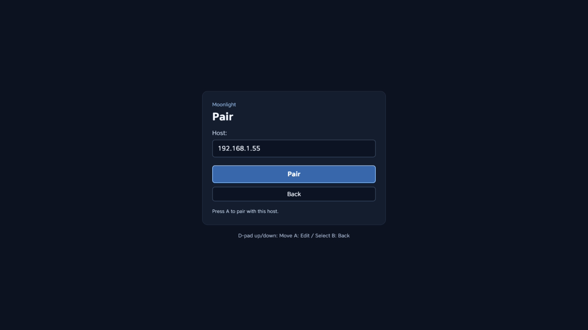
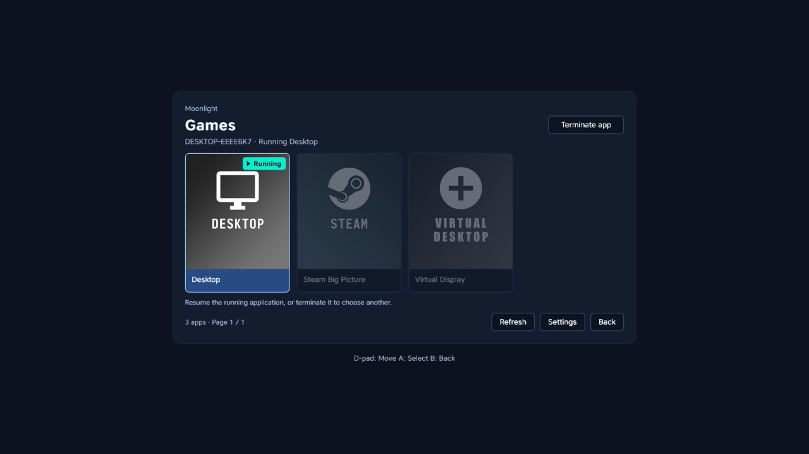
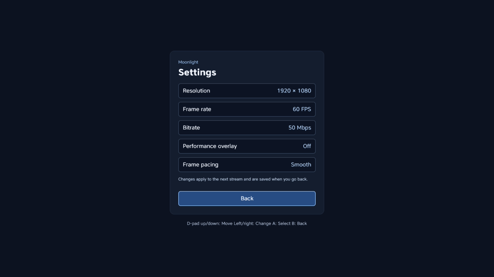
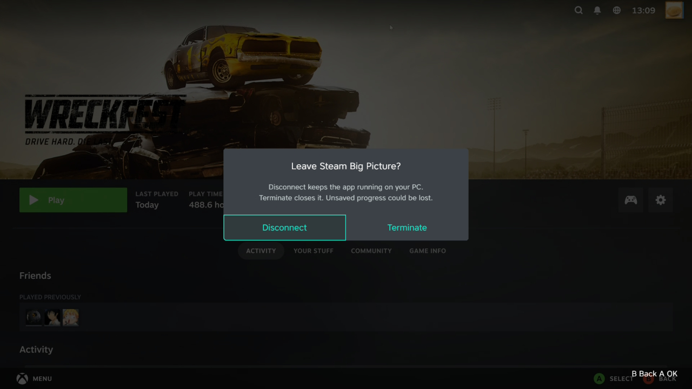

# Moonlight for CivSwitch

Stream your PC games to Nintendo Switch 2 through Civilization VII.
An experimental [Moonlight](https://moonlight-stream.org/) client running inside
[Gezine’s CivSwitch](https://github.com/Gezine/CivSwitch), with
Sunshine pairing, a game library, controller input, video and stereo audio.

**Tested on Switch 2.** Requires the Switch 1 edition of Civilization VII on a
physical cartridge, version **1.0.0**, with CivSwitch already set up. Compatibility
with other Switch models has not been established.

## Screenshots

| Pairing | Game library |
| :---: | :---: |
| [](docs/images/pairing.jpg) | [](docs/images/games.jpg) |
| **Stream settings** | **Streaming controls** |
| [](docs/images/settings.jpg) | [](docs/images/streaming.jpg) |

*Captured on Switch 2. Click a screenshot to enlarge.*

## Installation

Have [Sunshine](https://github.com/LizardByte/Sunshine) running on your PC and
connect the PC and Switch to the same local network. Choose either method below.

### 1. CivHomebrew — recommended

1. Set up [CivHomebrew](https://github.com/XITRIX/CivHomebrew) on your Switch.
2. Get a `moonlight.civapp` package, or build one using the instructions below.
3. In CivHomebrew, open **Y Options → FTP** and enable the FTP server.
4. Connect an FTP client to the Switch (default port **5000**) and upload
   `moonlight.civapp` into **Install civapp**.
5. Select **Moonlight** in the launcher and press **A**.

The app stays installed in the game’s save data, ready to launch from CivHomebrew.

### 2. Upload to Gezine’s launcher

Build the project below, then leave Gezine’s original CivSwitch loader waiting
for a payload. From the Moonlight repository, run:

```sh
python3 tools/send_ui.py SWITCH_IP
```

Replace `SWITCH_IP` with your console’s local IP address. The sender uploads the
streaming runtime and app automatically. Keep the terminal open while using it;
close Moonlight before uploading another payload.

## First launch

Choose **Pair new host**, enter your PC’s IP address, and approve the displayed
PIN in Sunshine. Select the paired PC, then choose a game or Desktop to stream.

- **D-pad / A:** navigate and select. **B:** go back or close Moonlight from Hosts.
- **− and + together:** open stream options. **Disconnect** returns to the library and keeps the PC app running; **Terminate** also closes the PC app. **B** dismisses the popup and resumes streaming.
- A running PC app appears first in the library; other cards are dimmed and disabled until it stops. Use **Terminate app** at the top right to close it.
- **Settings:** adjust resolution, frame rate, bitrate and frame pacing.
  Defaults are **720p, 60 FPS, 20 Mbps**.

Pairing and settings are saved between sessions.

## Build from source

Install **Git, Python 3.10+, Node.js 22+ with npm, CMake, and a C/C++ build toolchain**
(Xcode Command Line Tools on macOS, or build-essential on Linux). Then run:

```sh
git clone https://github.com/XITRIX/Moonlight-CivSwitch.git
cd Moonlight-CivSwitch
npm run bootstrap
npm run build
```

Bootstrap downloads the pinned dependencies and installs Emscripten **3.1.74**
locally; no global SDK setup or `npm install` is needed. The build produces
`dist/runtime/moonlight-stream.js`. You can now upload with `tools/send_ui.py`.
Run `npm run build` again after changing native runtime sources.

### Optional: create a .civapp package

After building, package from the Moonlight root with the included tool:

```sh
npm run package
```

This creates and validates `dist/moonlight.civapp`, ready to install using method 1
above. No separate CivHomebrew checkout is needed. `payload.json` defines the
bundled files and their order; rebuild the package after changing the app.
The single-file Python packager can also be copied into other repositories;
see [reuse and CI examples](tools/README.md).

### Development checks

```sh
npm test
npm run test:runtime
npm run test:ui
npm run test:package
```

Runtime checks require a completed build; package checks also require
`npm run package`. UI and package checks require Chrome; set
`CHROME_BIN` if needed. See the [build details](tools/wasm2js/README.md),
[streaming notes](docs/streaming.md) and [development routine](AGENTS.md) for more.

## Credits

- **[Gezine](https://github.com/Gezine/CivSwitch)** — CivSwitch and the loader
  that makes this possible.
- **[Moonlight](https://github.com/moonlight-stream/moonlight-common-c)** and
  **[Sunshine](https://github.com/LizardByte/Sunshine)** — streaming protocol,
  client core and host software.
- **[XITRIX / Moonlight-Switch](https://github.com/XITRIX/Moonlight-Switch)** —
  my original Switch client and the app icon used here.
- **[Emscripten](https://emscripten.org/)**, **[Mbed TLS](https://github.com/Mbed-TLS/mbedtls)**,
  **[Forge](https://github.com/digitalbazaar/forge)**, **ENet** and **nanors** —
  compiler, cryptography and networking foundations.

Third-party licenses and attribution are included in the
[bundled notices](app/civapp-notices.js).
